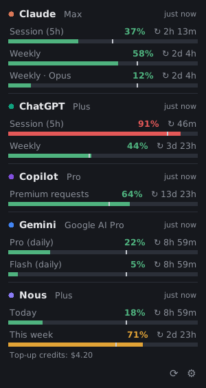
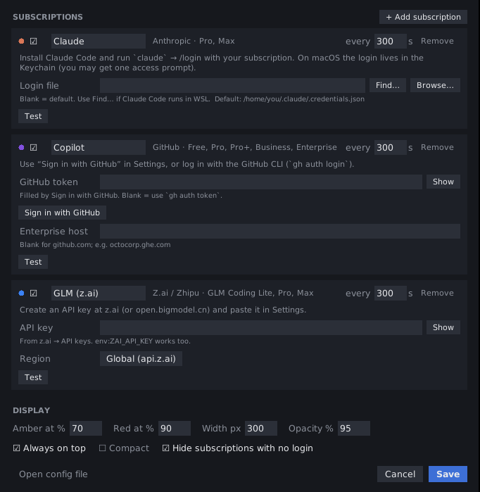
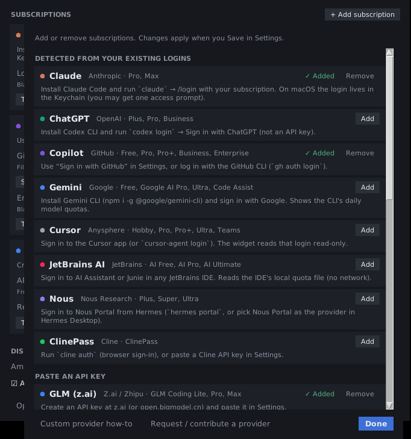

# SubUsage: AI subscription usage, on your desktop

A small, always-on-top desktop widget that shows how much of your AI **subscription** limits you've used: Claude, ChatGPT, GitHub Copilot, Gemini, Cursor, JetBrains AI, Nous and more. Each limit gets a bar, a reset countdown and a pace marker, so you don't have to keep opening each vendor's usage page.

Runs on **Windows, macOS and Ubuntu/Linux**. Pure Python standard library, no dependencies.

<p align="center">
  
</p>

> **Subscriptions, not API billing.** SubUsage tracks the limits on plans you pay for monthly (Claude Max, ChatGPT Plus, Copilot Pro…). It doesn't track pay-per-token API spend.

---

## Contents

- [Features](#features)
- [Supported subscriptions](#supported-subscriptions)
- [Install](#install)
- [Using the widget](#using-the-widget)
- [Adding and configuring subscriptions](#adding-and-configuring-subscriptions)
- [Start at login](#start-at-login)
- [Platform notes](#platform-notes)
- [Privacy and security](#privacy-and-security)
- [Command line](#command-line)
- [Troubleshooting](#troubleshooting)
- [How it works (and its limits)](#how-it-works-and-its-limits)
- [Contributing](#contributing)
- [License and acknowledgements](#license-and-acknowledgements)

## Features

- **Every limit at a glance:** 5-hour sessions, weekly caps, daily model quotas, monthly credits, each with a reset countdown.
- **Pace marker:** a white tick on each bar shows where you'd be if you used the window evenly. If the bar is past the tick, you're burning faster than the window allows.
- **Color thresholds:** green, then amber (70%), then red (90%). Both thresholds are adjustable.
- **Uses the logins you already have:** reads the sign-in saved by Claude Code, Codex CLI, Gemini CLI, the Cursor app, JetBrains IDEs, Hermes and more. There are no passwords to enter.
- **Add / remove from a catalog:** pick from the built-in subscriptions, paste an API key for key-based plans, or plug in anything else with a custom command.
- **Settings window:** a login-file field for each subscription with **Find…** (also searches WSL on Windows), **Browse…** and **Test**, plus one-click **Sign in with GitHub** for Copilot.
- **Gentle on vendors:** polls every 5 minutes by default, backs off on rate limits (honoring `Retry-After`), and keeps showing the last good data while it waits.
- **Compact mode, opacity and always-on-top**, plus start at login on all three OSes.

## Supported subscriptions

| Subscription | Plans | How it signs in | What it shows |
|---|---|---|---|
| **Claude** (Anthropic) | Pro, Max | Claude Code login (file, or macOS Keychain) | 5-hour session, weekly, per-model weekly, extra usage |
| **ChatGPT** (OpenAI) | Plus, Pro, Business | Codex CLI login (`codex login`) | 5-hour and weekly Codex limits, credits |
| **Copilot** (GitHub) | Free, Pro, Pro+, Business, Enterprise | Sign in with GitHub (in Settings) or `gh auth login` | Premium requests, chat/completions (Free) |
| **Gemini** (Google) | Free, Google AI Pro / Ultra, Code Assist | Gemini CLI login | Daily Pro / Flash / Flash Lite quotas |
| **Cursor** | Hobby, Pro, Pro+, Ultra, Teams | Cursor app login (read-only) | Included usage, Auto / API split, on-demand, team pool |
| **JetBrains AI** | AI Free, AI Pro, AI Ultimate | Local IDE quota file (no network) | Monthly credits, top-up credits |
| **Nous Portal** | Plus, Super, Ultra | Hermes Agent / Hermes Desktop login | Daily, weekly, monthly allowances, top-ups |
| **GLM Coding Plan** (Z.ai) | Lite, Pro, Max | API key | 5-hour, weekly, MCP calls |
| **Kimi Code** (Moonshot) | Moderato, Allegretto, Allegro | API key | 5-hour, weekly, monthly |
| **Synthetic** | Standard, Pro | API key | Weekly, search hourly |
| **ClinePass** (Cline) | ClinePass | `cline auth` login or API key | 5-hour, weekly, monthly |
| **Custom** | anything | a command you write | whatever it prints |

[PROVIDERS.md](PROVIDERS.md) has per-provider details (files read, endpoints, quirks). It also lists **28 more AI subscriptions** that aren't built in yet, such as Windsurf, Perplexity, Grok, Kiro and Warp. Those can be added today with a [custom command](#custom-providers), and native support is welcome as a [contribution](CONTRIBUTING.md).

## Install

### 1. Python 3.10+ with Tk

| OS | What to do |
|---|---|
| **Windows** | Install Python from [python.org](https://www.python.org/downloads/). Tk is included. |
| **macOS** | Python from [python.org](https://www.python.org/downloads/) includes Tk. With Homebrew Python, also run `brew install python-tk`. |
| **Ubuntu / Debian** | `sudo apt install python3 python3-tk` |
| **Fedora** | `sudo dnf install python3 python3-tkinter` |

### 2. Get SubUsage

```bash
git clone https://github.com/chrisdelrey/ai_subusage.git
cd ai_subusage
```

Or install it as a command with [pipx](https://pipx.pypa.io/):

```bash
pipx install git+https://github.com/chrisdelrey/ai_subusage.git
subusage            # run it
```

### 3. Check, then run

```bash
python3 -m subusage --once     # prints what it can read for each subscription, then exits
python3 -m subusage            # starts the widget
python3 -m subusage --demo     # sample data, no logins needed
```

On Windows, use `python` instead of `python3`. You can also double-click **`subusage.pyw`** to start the widget with no console window.

## Using the widget

| Action | How |
|---|---|
| Move it | Drag anywhere. The position is remembered. |
| Menu | Right-click (macOS: Ctrl-click or two-finger click) |
| Settings | Click **⚙** (bottom right) |
| Refresh now | Click **⟳**, or use the menu. There's a 60-second floor so you can't trip vendor rate limits. |
| Open a vendor's usage page | Double-click the subscription's name |
| Compact view | Menu → Compact: one line per subscription |

Subscriptions without a login on this machine are hidden. To list them anyway, turn off "Hide subscriptions with no login" in Settings.

## Adding and configuring subscriptions

Open **⚙ Settings → + Add subscription**. The picker groups everything by how it signs in:

- **Detected from your existing logins:** add it, and if you're signed in to that vendor's CLI or app, it just works.
- **Paste an API key:** add it, then paste the key in its Settings row.
- **Anything else:** a custom command (see below).
- **Not built in yet:** the rest of the catalog, with notes on where usage data could come from.

Each subscription's row in Settings has:

- **Login file** with **Find…** and **Browse…**. Leave it blank for the default location. On Windows, **Find…** also searches every WSL distro, which helps if Claude Code or Codex runs in WSL.
- **API key** for key-based plans. Write `env:VAR_NAME` to read the key from an environment variable instead of saving it.
- **Sign in with GitHub** (Copilot): shows a code, copies it, and opens github.com/login/device.
- **Test**: checks the login right away and shows the plan and current percentages.
- **Name, refresh interval, on/off, Remove.**

<p align="center">
  
  
</p>

**Save** applies changes immediately. Everything lives in a JSON config file you can also edit by hand:

| OS | Config file |
|---|---|
| Windows | `%APPDATA%\SubUsageWidget\config.json` |
| macOS | `~/Library/Application Support/SubUsage/config.json` |
| Linux | `~/.config/subusage/config.json` |

### Custom providers

Anything that can print a usage number can be a subscription. Write a script that prints JSON like this:

```json
{"plan": "Pro",
 "windows": [{"label": "Daily", "used_pct": 42.5,
              "resets_at": "2026-11-17T00:00:00Z", "length_seconds": 86400}],
 "notes": ["optional extra line"]}
```

Then go to Settings → + Add subscription → **Custom** and enter the command (for example `python ~/bin/my_usage.py`). Start from [`examples/custom_provider.py`](examples/custom_provider.py).

## Start at login

Right-click the widget → **Start at login**. What that does on each OS:

| OS | What it does | Undo |
|---|---|---|
| Windows | Adds `SubUsage` to `HKCU\…\CurrentVersion\Run` (runs `pythonw`, no console) | Untick, or Task Manager → Startup apps |
| macOS | Writes `~/Library/LaunchAgents/com.subusage.widget.plist` | Untick, or delete the file |
| Linux | Writes `~/.config/autostart/subusage.desktop` (10 s delay) | Untick, or delete the file |

It points at wherever SubUsage is installed. If you move the folder, untick and re-tick it. Only one copy of the widget runs at a time.

## Platform notes

**Windows**
- If a CLI runs inside **WSL**, use **Find…** in Settings. It finds logins under `\\wsl.localhost\<distro>\home\<you>\`. Reading a WSL path starts that distro if it isn't running.
- Copilot's `gh auth token` fallback needs the GitHub CLI on your PATH. **Sign in with GitHub** works without it.

**macOS**
- Claude Code stores its login in the **Keychain**. The first time, macOS asks whether Python may read the "Claude Code-credentials" item. Choose **Always Allow** to avoid repeat prompts.
- Recent Cursor builds encrypt the app token with the Keychain. If Cursor shows "token is encrypted", paste the `WorkosCursorSessionToken` cookie from cursor.com into Cursor's **Session token** field.
- Right-click is Ctrl-click or a two-finger click.

**Ubuntu / Linux**
- Install Tk: `sudo apt install python3-tk`.
- Transparency needs a compositing window manager (GNOME, KDE). Without one, the opacity setting is ignored.
- On Wayland, Tk runs through XWayland. Positioning and always-on-top usually work, but some compositors ignore them.

## Privacy and security

- **It only reads logins, never writes them.** SubUsage reads tokens that your CLIs and apps already saved. It never refreshes them on disk, rewrites them, or changes their permissions, so it can't sign you out of anything. Gemini is the one exception to "never refreshes": its short-lived token is refreshed **in memory only**.
- **It only talks to the vendors.** Each provider calls only its own vendor's usage endpoint. There's no telemetry, no analytics, and no third-party server.
- **Secrets in the config file:** API keys and the Copilot token you add in Settings are stored in plain text in your config file. On macOS/Linux the file is `chmod 600`; on Windows it lives in your user-only `%APPDATA%`. To keep a key out of the file entirely, use `env:VAR_NAME`.
- **The source is small:** one file per provider under `subusage/providers/`. Read it before you run it.

## Command line

```
python3 -m subusage              start the widget
python3 -m subusage --once       fetch every subscription once, print, exit
python3 -m subusage --once --json    same, as JSON (handy for scripts and bug reports)
python3 -m subusage --demo       sample data, no logins
python3 -m subusage --settings   start with the Settings window open
python3 -m subusage --version
```

## Troubleshooting

| Symptom | Fix |
|---|---|
| A subscription doesn't appear | It has no login on this machine. Run `--once` to see why, or turn off "Hide subscriptions with no login". |
| "Token expired; open … once" | The CLI's saved login is stale. Run that CLI once (`claude`, `codex`, `gemini`, `hermes`) and it refreshes. |
| "Rate limited, retrying in …" | The vendor throttled its usage endpoint. Claude's is strict: keep its interval at 300 s or more. Old data stays visible. |
| Copilot: "didn't accept the GitHub CLI token" | Use **Sign in with GitHub** in Settings instead of the `gh` fallback. |
| Cursor: "token is encrypted" | Paste a cursor.com session token (see [macOS notes](#platform-notes)). |
| JetBrains numbers look old | The IDE only saves its quota file now and then. Open the IDE to update it. |
| `tkinter` missing | Ubuntu: `sudo apt install python3-tk`. Homebrew: `brew install python-tk`. |
| Nothing happens on launch | Another copy is already running (one copy per user). Check the log: menu → Open log. |

Logs are in the same folder as the config file (`widget.log`).

## How it works (and its limits)

Most vendors don't publish an API for subscription usage. SubUsage uses the same internal endpoints the vendors' own tools use: Claude Code's `/usage`, Codex's `/status`, Copilot's IDE plugin, Gemini CLI's quota API, and so on. That means:

- **Any provider can break** when a vendor changes something. The others keep working, and the broken one shows a warning. Please [open an issue](https://github.com/chrisdelrey/ai_subusage/issues) with the `--once --json` output, with tokens removed.
- **The numbers are the vendor's.** SubUsage displays what the endpoint reports and doesn't estimate anything.
- **Per-surface splits aren't available.** For example, Claude's limits are shared across claude.ai, Desktop and Claude Code, and the endpoint reports only the combined total.

## Contributing

Contributions are very welcome, especially **new providers**. Each one is a single file with one `fetch()` method. Settings rows are generated from the fields it declares, so no UI code is needed. See [CONTRIBUTING.md](CONTRIBUTING.md) for the walkthrough, the test helpers and the PR checklist.

```bash
python3 -m unittest discover -s tests -t .
```

## License and acknowledgements

[MIT](LICENSE).

- The **[CodexBar](https://github.com/steipete/CodexBar)** project (MIT, by Peter Steinberger) documents many of these usage endpoints. It was an invaluable reference.
- **[Hermes Agent](https://github.com/NousResearch/hermes-agent)** (MIT, Nous Research) shows how Nous Portal usage is fetched.

SubUsage is an independent project, not affiliated with or endorsed by Anthropic, OpenAI, GitHub, Google, Anysphere, JetBrains, Nous Research, Z.ai, Moonshot AI, Synthetic or Cline. All product names and trademarks belong to their owners.
